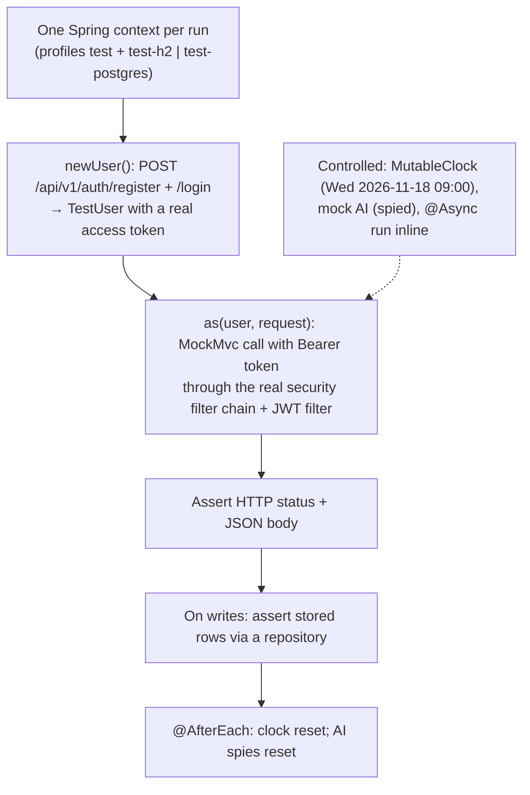

# Backend test flows

This map shows which test covers each user flow, business rule and external connection. The rules for writing tests are in `CLAUDE.md` → "Testing strategy" and constitution Principle II.

- **Last verified:** 2026-11-23, branch `feat/F008-backend-testing-structure`. 136 tests: 76 component, 53 unit, 7 integration. One Spring context per run. About 24 s on H2 and 26 s on Postgres (full `./gradlew test`).
- **Keep it current:** update this file when you add, remove or change a test class.

## 1. How a component test runs

| Run | Command | Database |
|---|---|---|
| Local (default) | `./gradlew test` | H2 in memory; `@RequiresPostgres` tests are skipped |
| Like CI | `./gradlew test -PtestDb=postgres` | Testcontainers `postgres:17` (Docker needed) |
| One class | `./gradlew test --tests '*SignInComponentTest'` | either |

Every refusal check uses `error(HttpStatus.X)`, which also checks the `ApiError` body shape (`status`, `error`, `message`, `timestamp`). `TestStructureRulesTest` fails on a bare status check.

## 2. Main user flows → component tests

| Flow | Test class | Tests | Success path | Refusals covered |
|---|---|---|---|---|
| Sign up, sign in, keep the session, sign out | `SignInComponentTest` | 12 | register 201; login 200 with token and HttpOnly refresh cookie; refresh 200; logout clears the cookie | wrong email/password → 401 (same body); duplicate email → 409; refresh with no, unknown, revoked, expired or orphan token → 401 |
| Onboarding: empty weekday and weekend routines | `OnboardingComponentTest` | 5 | registration creates both; a legacy user gets a weekend routine once; `type` defaults to DAILY | `type=FOO` → 400; no token → 401 |
| Edit the weekday template | `DefaultRoutineComponentTest` | 7 | add tasks (end times computed); one overlap shift; rename; delete; replace routine | unknown colour → 400 with nothing stored; no token → 401 |
| A day from the template, and daily tasks | `DailyRoutineComponentTest` | 6 | today copied and stored; other days read without being created; Saturday from the weekend template; add / complete / rename / delete | Buddy can't add to or reschedule a past day; no token → 401 |
| Task colours | `TaskColorComponentTest` | 8 | auto colour + `nextColor`; chosen colour stored; update without colour keeps it; delete doesn't rewind; new day copies colours and cursor; midnight spawn copies colours; palette order; Buddy sets palette names | unknown colour → 400 on create and update; Buddy refuses hex and unknown names |
| Account settings and profile | `UserSettingsComponentTest` | 11 | defaults; PATCH stored and marked customized; partial PATCH; profile without secrets; corrupt or unknown stored rows ignored | invalid PATCH → 400 with nothing written; unknown user 404; another user 403; no token 401 |
| Chat with Buddy (history) | `ChatHistoryComponentTest` | 11 | exchanges stored in order; one conversation per routine and per date; context passed to the AI; paging back with no gaps | blank message or missing date → 400; unknown user or another user's routine → 404; AI failure → 5xx with nothing stored; no token → 401 |
| Chat compaction | `ChatCompactionComponentTest` | 2 | at 20 messages the context is summarised; visible history unchanged; summary never returned | summariser failure: chat keeps working and compaction retries |
| Daily reflection | `ReflectionComponentTest` | 14 | plan copied once; reading creates nothing; reality and plan are independent; Buddy's note and staleness; separate reflection chat | future date → 400; validation → 400; edits before creation → 404; another user's task → 404; unknown user 404; AI note failure → 503 keeping the old note; no token → 401 |

Today is Wednesday 2026-11-18 in every component test (`clock`). Move it with `clock.setToday(...)` or `clock.advance(...)`.

## 3. Core business rules → unit tests

| Rule | Code | Test | Tests |
|---|---|---|---|
| Colour round-robin, preselection, same-name sharing, validation | `service/TaskColorService` | `TaskColorServiceTest` | 8 |
| Overlap shifting (template and daily) | `funcs/TaskTimeFunctions` | `TaskTimeFunctionsTest` | 8 |
| Weekday vs weekend template | `funcs/RoutineTemplateRules` | `RoutineTemplateRulesTest` | 9 |
| Past / future day | `funcs/DayRules` | `DayRulesTest` | 4 |
| History page size; compaction due | `config/ChatHistoryProperties` | `ChatHistoryPropertiesTest` | 4 |
| Plan-vs-reality grouping | `service/reflection/ReflectionComparisonService` | `ReflectionComparisonServiceTest` | 6 |
| Settings values, defaults, adding a preference | `service/UserSettingsRegistry` | `UserSettingsRegistryTest` | 11 |
| Palette contrast (WCAG AA, both themes) | `application.yml` palette | `TaskPaletteContrastTest` | 1 |
| Test-suite shape (packages, names, one context; refusals checked with `error(..)`) | test classes | `TestStructureRulesTest` | 2 |

## 4. External connections → integration tests

| Connection | Test | Runs on |
|---|---|---|
| Spring Security + JWT filter: valid token accepted; missing, non-Bearer, garbage, tampered or foreign-signed token → 401 with the `ApiError` body | `JwtSecurityIntegrationTest` (6) | H2 and Postgres |
| PostgreSQL row lock on a conversation: concurrent chat messages get unique, gap-free sequence numbers | `ChatSequenceLockingIntegrationTest` (1) | Postgres only (`@RequiresPostgres`) |

## 5. Endpoint coverage

✅ = covered through HTTP with a real token

| Endpoint | Covered by |
|---|---|
| `POST /api/v1/auth/register`, `/login`, `/refresh`, `/logout` | SignIn ✅ |
| `GET /api/v1/default-routine/users/{userId}` | Onboarding, DefaultRoutine, TaskColor ✅ |
| `POST /api/v1/default-routine/{routineId}/tasks`, `PUT /tasks`, `DELETE /tasks`, `PUT /{id}` | DefaultRoutine, TaskColor ✅ |
| `POST /api/v1/default-routine/users/{userId}` | — (not used by the frontend) |
| `GET` / `POST /api/routine-manager/daily-routine/{userId}` | DailyRoutine, TaskColor, Reflection ✅ |
| `POST /api/routine-manager/daily-routine/{routineId}/tasks`, `PUT /tasks`, `DELETE /tasks` | DailyRoutine, TaskColor ✅ |
| `/api/routine-manager/daily-reflection/{userId}/{date}` (all) | Reflection ✅ |
| `/api/ai/chat/**` (send + history, all three kinds) | ChatHistory, ChatCompaction, Reflection ✅ |
| `GET` / `PATCH /api/v1/users/{userId}/settings`, `GET …/profile` | UserSettings ✅ |
| `GET /api/v1/task-palette` | TaskColor ✅ |
| `POST /api/support/cron/spawn-daily-task` | TaskColor ✅ |
| `GET` / `POST /api/users/{userId}/onboarding/complete` | — |

## 6. Known gaps (filed as bugs, not covered on purpose)

- The default/daily routine endpoints don't check that the routine belongs to the caller. Tests don't assert either way (`AI-project-docs/bugs/`).
- Buddy's update/delete tools read lazy task lists without a transaction. Tests call them inside one (`AI-project-docs/bugs/`).
- The `prod` profile (open-in-view off) can't serialise routine entities. Tests use the `test` profile, which the EC2 backend runs (`AI-project-docs/bugs/`).
- No AI-provider integration test yet (needs a local stand-in for the Gemini API).
